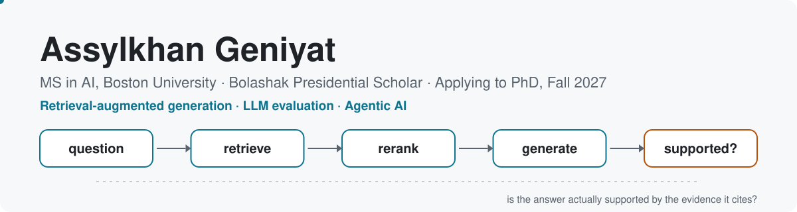

<!-- kuromi1kow / kuromi1kow: GitHub profile README.
     GitHub strips inline CSS, so the look comes from the SVG banner and shields.io badges.
     Banners: assets/banner-light.svg and assets/banner-dark.svg. -->

  <a href="https://kuromi1kow.github.io">
    <picture>
      <source media="(prefers-color-scheme: dark)" srcset="assets/banner-dark.svg"/>
      
    </picture>
  </a>

  <strong>Applying to PhD programs for Fall 2027</strong> 
  Boston University · Boston, MA · MS in AI expected May 2027

  
  
  
  

&nbsp;

Originally from Kazakhstan, now based in Boston.

I'm an MS student in Artificial Intelligence at Boston University, funded by the Bolashak Presidential Scholarship, and I receive research mentorship from Prof. Aaron Mueller. I study **retrieval-augmented generation (RAG)**: whether the answers of large language models are actually supported by the evidence they cite, and how to train retrieval systems so that they are.

Before graduate school I was the primary ML engineer at the National Bank of Kazakhstan, building retrieval and AI-agent systems over 80,000+ financial and legal documents. I also teach AI and data science as a part-time lecturer in Astana Hub's Tech Orda program.

&nbsp;

| | |
|---|---|
| [**ChunkRAG**](https://github.com/kuromi1kow/chunkrag-course-project) | Does literal-match reranker supervision improve generated answers in RAG? An in-domain (TechQA) and transfer (Doc2Dial) study, with the paper, supplement and LaTeX sources |
| [**Video Moment Retrieval**](https://github.com/kuromi1kow/Interpretability-and-Failure-Analysis-for-Video-Moment-Retrieval) | BU CS585 team project: reproduced Moment-DETR, QD-DETR and CG-DETR on QVHighlights, then analysed temporal bias, verb vs. noun sensitivity and attention heads |
| [**AI in Molecular Docking**](https://github.com/kuromi1kow/AI-in-Molecular-Docking) | Bachelor's thesis: an ML and reinforcement-learning pipeline for virtual drug screening (Random Forest, 1D CNN, PPO-based SMILES generator) |

`Retrieval-Augmented Generation` · `Reranking` · `LLM Evaluation` · `Agentic AI` · `Reasoning` · `Efficient AI Systems`

&nbsp;

- [**Does Literal-Match Reranker Supervision Improve Generated Answers in RAG? An In-Domain and Transfer Study**](https://kuromi1kow.github.io/publication/2026-literal-match-reranker-supervision) — **A. Geniyat**, Z. Fakhriddinov, A. Gulati. *Under review, Engineering Applications of Artificial Intelligence* (2026)
- [**Answer Support Is Not Citation Correctness: A Matched-Evidence Study of Local Scientific RAG**](https://kuromi1kow.github.io/publication/2026-answer-support-citation-correctness) — Z. Fakhriddinov, **A. Geniyat**, A. Gulati. *Under review, Engineering Applications of Artificial Intelligence* (2026)
- [**The Role of Computer Technologies in Formulating Effective Headlines for Russian-Language Media**](https://ieeexplore.ieee.org/document/10585477) — D. Alkhaidar, **A. Geniyat**, I. Akhmetvaliyeva. *2024 IEEE AITU: Digital Generation*, pp. 140–145 · 2nd place among 27 AI research papers

&nbsp;

| Role | Where | When |
|---|---|---|
| Lecturer, AI & Data Science (part-time) | Astana Hub, Tech Orda program | 2026 – now |
| Instructional Technology Developer | Boston University | 2026 – now |
| Machine Learning Engineer (primary AI/ML engineer) | National Bank of Kazakhstan | 2025 |
| Machine Learning Engineer | Ministry of Energy of Kazakhstan | 2025 |

&nbsp;

| | |
|---|---|
| [**Amazon Movie Review Rating Prediction**](https://github.com/kuromi1kow/amazon-movie-review-rating-prediction) | Kaggle competition (BU CS506): predicting 1–5 star ratings with classical ML, using negation-aware TF-IDF, VADER sentiment, out-of-fold target encoding and expected-value logistic regression (CV RMSE ≈ 0.677) |
| [**gov-news-ministry-predictor**](https://github.com/kuromi1kow/gov-news-ministry-predictor) | Russian-language news classifier that routes articles to the responsible government ministry (TensorFlow) |
| [**TgBotWithTenserFlowRealization**](https://github.com/kuromi1kow/TgBotWithTenserFlowRealization) | Telegram music recommendation bot built on collaborative filtering |
| [**IEEE_sb_web_site**](https://github.com/kuromi1kow/IEEE_sb_web_site) | Website for the IEEE Student Branch at Astana IT University |
| [**ReactGraph**](https://github.com/kuromi1kow/ReactGraph) | Candlestick crypto chart built with React and ECharts |

&nbsp;

  
  
  
  
  
  
  
  
  
  
  
  
  

&nbsp;

Happy to talk about RAG evaluation, faithful generation and PhD opportunities: [asylhangeniat@gmail.com](mailto:asylhangeniat@gmail.com)

  <!-- Snake animation generated daily by .github/workflows/snake.yml into the `output` branch -->
  <picture>
    <source media="(prefers-color-scheme: dark)" srcset="https://raw.githubusercontent.com/kuromi1kow/kuromi1kow/output/github-snake-dark.svg"/>
    
  </picture>
  <code>question → retrieve → rerank → generate → verify · repeat</code>

